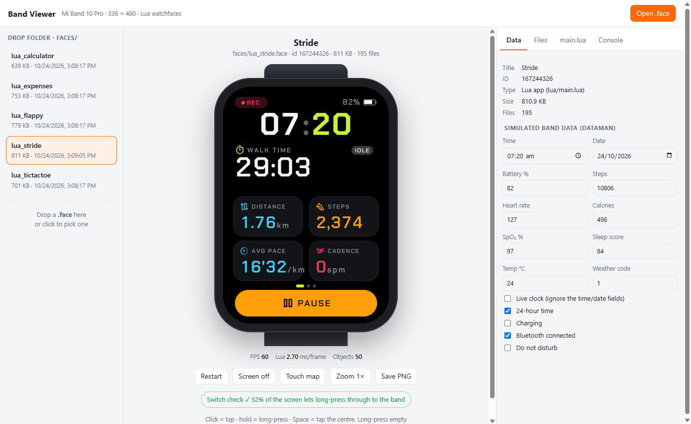

<div align="center">

# Band Viewer

**Run Mi Band 10 Pro watchfaces in your browser.**
Drop in a `.face`, tap it, long-press it and feed it fake health data, all before it ever touches your wrist.

[](#)
[](#quick-start)
[](#how-it-works)
[](LICENSE)



</div>

## Why

Testing a watchface on the band means building it, sending it to your phone, installing it over Bluetooth, selecting it,
and hoping it doesn't lock you out. Band Viewer cuts that down to **save → look**.

## Features

- ⚡ **Hot reload**: drop `.face` files in `faces/`, and they reload by themselves when rebuilt
- 👆 **Real input**: click = tap, hold = long-press, Space = tap the centre
- 🫀 **Fake band data**: time, date, battery, steps, heart rate, calories, SpO₂, sleep, weather, charging, Bluetooth, DND
- 🛟 **Switch check**: warns if a face grabs every touch and would trap you on the band
- 🔍 **Inspect**: every file inside the `.face`, the `main.lua` source, and a console with `print()` output and Lua errors
- 💾 **Persistent storage**: `/data` writes survive reloads, like on the band. One click clears them.
- 🖼️ **Save PNG**: a 336 × 480 screenshot, ready to use as the face's `preview.png`
- 📊 **FPS, Lua ms per frame and object count**, so you can spot slow faces early

## Quick start

```bash
git clone https://github.com/hassan-xsf/band-viewer
cd band-viewer
python serve.py        # or double-click start.bat on Windows
```

It opens `http://127.0.0.1:8770` and serves only on your own machine. Drop a `.face` into `faces/`, onto the page, or onto `start.bat`.

Need faces to try? Grab some from **[Mi Band 10 Pro Faces](https://github.com/hassan-xsf/miband10pro-faces)**.

## How it works

The browser unpacks the `.face` itself. `main.lua` runs on [fengari](https://fengari.io), a Lua VM written in
JavaScript. [`lvgl_shim.lua`](lvgl_shim.lua) provides the band's `lvgl` (luavgl) and `dataman` APIs on a canvas: objects,
images, labels, flags, events, timers, `pageOnPause`/`pageOnResume` and data subscriptions.
`serve.py` is about 80 lines of stdlib Python that lists the faces and serves them.

```
faces/*.face ──► serve.py ──► index.html ──► fengari (Lua) + lvgl_shim ──► <canvas> 336×480
```

## Limits

It's an emulator, not the band. Fonts, timing and a few less common widgets differ slightly, and native (C) apps don't
run. Always do a final check on the real band.

## Troubleshooting

**Faces fail to load / `ERR_CONNECTION_RESET`.** Your antivirus web shield (Avast, AVG and others) is scanning local HTTP
traffic and cutting large downloads. Add an exception for `http://127.0.0.1:8770`, or turn off HTTP scanning for local
addresses.

**Port 8770 is busy.** A viewer is probably already running. `serve.py` just opens the existing one.

## Credits

- [fengari](https://github.com/fengari-lua/fengari-web) (MIT): Lua in the browser
- [m0tral](https://github.com/m0tral): his [Lua watchface examples](https://github.com/m0tral/MiWatchLuaWatchfaces) and
  [EasyFace](https://github.com/m0tral/EasyFace) compiler documented the band's Lua API and `.face` format this emulates
- MiSans font: Xiaomi (MiSans license)

## License

[MIT](LICENSE) © Hassan Shakil
